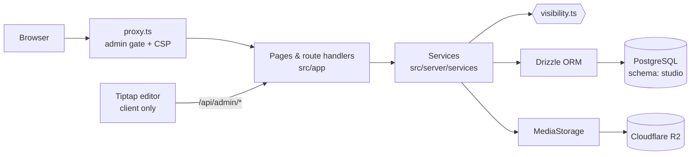

# SparkTime

**Free, practical guides for engineers in India, on a publishing platform I built from scratch.**

[](https://sparktime.in)


[sparktime.in](https://sparktime.in) is my writing site: 280+ articles on software engineering, careers
and money, organised into topic hubs and five multi-part courses (System Design, Java to Spring Boot,
DSA, off-campus placements, and using AI well). This repository is the platform behind it.

I didn't want a theme on a hosted CMS. I wanted a site I could keep adding to for years without
redeploying every time I invent a new kind of page, on free tiers only. So every page here (an
article, a course, a project, an interview write-up, the About page) is a **document** of a
**content type**, and types, fields, taxonomy and navigation are all edited in a private studio at
`/admin`. A new section of the site is a database row, not a code change.

> This is a public snapshot of the code that runs sparktime.in. Day-to-day development happens in a
> private repository; this copy is updated periodically.

## What's interesting in here

**One visibility rule, enforced in SQL.** `src/server/services/visibility.ts` is the only place that
decides whether a document is publicly readable, listed or indexable. Pages, search, RSS, sitemap,
backlinks and the knowledge graph all compose the same Drizzle predicates, and
`tests/db/visibility.test.ts` checks that drafts and private documents never leak through any of them.

**Search without a search service.** A generated, weighted `tsvector` column (title A, excerpt B,
body D) with a GIN index gives ranked full-text search, prefix matching gives as-you-type results, and
a trigram index catches typos. User input is reduced to letter/number tokens before it gets near
`to_tsquery`, so query syntax can't be injected.

**The database supplies data, never code.** Templates, field types, block types and icons are
allowlists in `src/lib/content/model.ts`. The database chooses from them; it never supplies markup,
CSS or scripts. Editor output (Tiptap/ProseMirror JSON) is sanitised on the server before it is stored.

**Owner-only admin, checked three times.** GitHub OAuth with `state` and PKCE (S256), limited to one
allowlisted account. Sessions live in Postgres, and only the SHA-256 of the cookie token is stored, so
a database leak doesn't hand out sessions. `src/proxy.ts` turns away requests without a cookie, then
every admin page and every `/api/admin/*` handler re-validates the session, the allowlist and the
request origin (CSRF) on its own. Admin pages get a nonce-based CSP with `strict-dynamic`.

**Locked down at the database too.** Tables live in a dedicated `studio` schema. Migration
`0002_lockdown.sql` enables row-level security with no policies and revokes Supabase's `anon` and
`authenticated` roles, so the hosted REST API can't read anything even if it's switched on.

**Migrations gate deploys.** `scripts/migrate-on-deploy.ts` runs pending migrations inside the
production Vercel build. A failed migration fails the build, so the previous deployment stays live.
Pooler connection-capacity errors are retried with backoff; real migration errors fail immediately.

**Rate limits that survive serverless.** Counters are stored in Postgres and updated with one atomic
`INSERT … ON CONFLICT DO UPDATE` per check, so they hold across instances and cold starts. Client IPs
are HMAC-hashed and never stored raw.

**Media you can't spoof.** Uploads are identified by their magic bytes, not by extension or the
client's MIME type, resized once with Sharp into WebP variants, and stored behind an interface:
Cloudflare R2 in production, the local filesystem in development.

**You can leave.** Full export to JSON + Markdown + a media manifest, and import of Markdown/HTML
folders, including Notion and Obsidian exports. Restore refuses to run unless the target database is
empty.

## Architecture



Public pages are rendered with ISR and revalidated on demand after every write that affects them, so
an unknown slug returns a real `404` and a renamed slug a real `308`. An ESLint rule stops client
components and the editor from importing `@/server/*`, so server secrets can't be bundled into the
browser by accident.

More detail: [docs/ARCHITECTURE.md](docs/ARCHITECTURE.md) and [docs/SECURITY.md](docs/SECURITY.md).

## Tech stack

| Concern | Choice |
| --- | --- |
| Framework | Next.js 16 (App Router), React 19, TypeScript (strict) |
| Database | PostgreSQL via Drizzle ORM and postgres.js; 22 tables, 6 SQL migrations |
| Local database | PGlite (Postgres compiled to WebAssembly), so no Docker or accounts needed |
| Editor | Tiptap 3 (ProseMirror) |
| Validation | zod 4 |
| Media | Sharp, Cloudflare R2 via aws4fetch |
| Auth | GitHub OAuth + PKCE, database sessions, single allowlisted owner |
| Tests | Vitest (unit + database tests on in-memory PGlite), Playwright (end-to-end) |
| Hosting | Vercel, Supabase Postgres, Cloudflare R2, all on free tiers |

## Testing

```bash
npm run typecheck   # tsc --noEmit
npm test            # Vitest: unit tests + database tests on in-memory PGlite
npm run test:e2e    # Playwright; refuses to run against anything but a local server
npm run check       # typecheck → lint → test → build
```

The suite has **725 tests across 56 files**, all passing (last run 26 Oct 2026, Node 22). The database tests don't mock the database: they run
against a real (in-memory) Postgres and send unauthenticated, non-owner, forged-cookie and cross-site
requests to the actual admin route handlers. They also cover visibility, publishing, import/export
round-trips and media deletion.

## Run it locally

Requires Node.js 20.9+ and npm. No accounts needed.

```bash
npm install
cp .env.example .env.local        # then set AUTH_SECRET and AUTH_DEV_LOGIN=true
npm run db:local                  # terminal 1: Postgres in WebAssembly on :54329
npm run db:setup                  # terminal 2: migrate + seed (idempotent)
npm run dev                       # http://localhost:3000
```

Open `/admin/login` and choose **Local development sign-in** (only available when
`NODE_ENV=development` and `AUTH_DEV_LOGIN=true`). PGlite serves one connection at a time, which is
why the local settings use a pool of one; point `DATABASE_URL` at any Postgres 15+ instead if you prefer.

## Project layout

```
drizzle/        SQL migrations (schema "studio", RLS lockdown)
scripts/        local DB, migrate, migrate-on-deploy, seed, export, import, site audit
src/app/        routes: (site) public pages, admin/ studio, api/
src/components/ site, content renderer, templates, admin UI
src/editor/     Tiptap block editor (client only)
src/lib/        pure shared code: content model, sanitiser, URLs, SEO builders
src/server/     server only: env, db, auth, http guards, services, media, seo
src/proxy.ts    request proxy: admin gate + nonce CSP
tests/          unit/, db/ and e2e/ suites
```

## Known limitations

- Single owner by design: there are no roles or multi-user editing.
- The rate limiter is fixed-window, so a client can burst up to twice the limit across a window boundary.
- Local PGlite handles one connection at a time; it's for development only.

## About me

I'm Karthikeyan, a software engineer at Capgemini working on AWS infrastructure (CDK, TypeScript), and
the founder of [SparkTribe](https://sparktribe.in), a placement-prep platform for Tamil-speaking
students. More at [sparktime.in/about](https://sparktime.in/about) ·
[LinkedIn](https://www.linkedin.com/in/trendiikarthii) · [GitHub](https://github.com/Karthiikeyan).

The code is shared so you can read how it works. The articles on sparktime.in are my own writing and
aren't covered by any licence to reuse.
