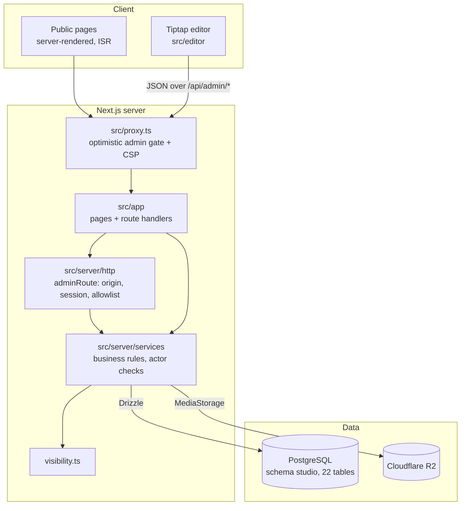

# Architecture

SparkTime is a Next.js App Router application over a single PostgreSQL database. There is no
third-party CMS, no search service and no separate API server. This document explains how the pieces
fit together and why.

## Layers



| Directory | Rule |
| --- | --- |
| `src/lib/` | Pure code shared by server and client: content model, block sanitiser, slug/URL safety, JSON-LD builders. No I/O. |
| `src/server/` | Server-only (`import "server-only"`): env, database, auth, HTTP wrappers, services, media, SEO. |
| `src/editor/` | The block editor. Talks to the server only through `/api/admin/*`. |
| `src/components/` | Public site, content renderer, templates, admin UI. |

An ESLint rule blocks client components and the editor from importing `@/server/*` (type-only imports
excepted), so a server secret can't end up in a browser bundle by accident.

## The content model

Everything a visitor can read is a row in `documents`. Each document belongs to a **content type**
(`content_types`) that defines its template, URL routing, schema.org type, and a list of custom fields
(`content_type_fields`). Types are edited in the studio, so "Talks", "Courses" or "Interview
Experiences" are data, not code.

The database never decides *how* something renders. Templates, field kinds, block kinds, icons and
relation kinds are allowlists in `src/lib/content/model.ts`; a type row can only pick from them.

Around documents:

- **Taxonomy**: a category tree (`categories`) plus flat `tags`.
- **Relations**: typed links between documents (`document_relations`), either added by hand or derived
  from links inside the body, which drives backlinks and the knowledge graph.
- **Collections**: ordered lists (`collection_items`), used for the multi-part courses.
- **Site structure**: `navigation_items`, `redirects`, `site_settings`.
- **Operations**: `audit_logs`, `contact_messages`, `rate_limits`, and the import tables.

### Lifecycle and visibility

A document has a **status** (`idea`, `draft`, `scheduled`, `published`, `archived`) and a
**visibility** (`private`, `unlisted`, `public`). Trash is deliberately not a status, so no status
picker or import can put a document there.

`src/server/services/visibility.ts` is the only code that turns those two fields into decisions:

| Predicate | Meaning | Used by |
| --- | --- | --- |
| accessible | may be served at its URL: published/archived and public/unlisted | page routes |
| listed | may appear in discovery: published and public | lists, search, RSS, sitemap, related, graph, backlinks |
| indexable | listed (or unlisted with an explicit opt-in), type indexable, not `noindex` | robots meta, sitemap |

Each predicate exists as a TypeScript function and as a Drizzle SQL fragment, and every public query
composes the SQL version. `tests/db/visibility.test.ts` creates documents in every combination and
checks each read path.

Edits to a document that is already published are **staged**: the live version keeps serving until
"Publish changes" applies the staged body.

## Rendering and caching

Public pages are statically generated and cached (ISR). Any write that could change what visitors see
(publish, rename, relation change, settings) calls `invalidatePublicSite()`, which revalidates the
whole site layout. Pages interlink heavily (counts, related content, navigation), so site-wide
invalidation is simpler and still cheap: each page re-renders lazily on its next request.

Because routing is resolved against the database at request time, unknown slugs return a real `404`
and renamed slugs return a `308` to the new path from the `redirects` table.

Admin pages and `/api/admin/*` responses are never cached (`Cache-Control: no-store`).

## Search

`documents.search_vector` is a generated, stored `tsvector`:

```sql
setweight(to_tsvector('english', title), 'A')
|| setweight(to_tsvector('english', excerpt), 'B')
|| setweight(to_tsvector('english', search_extra), 'B')   -- taxonomy and field text
|| setweight(to_tsvector('english', left(plain_text, 250000)), 'D')
```

It has a GIN index, and `title` also has a trigram (`gin_trgm_ops`) index. A query is reduced to at
most 8 letter/number tokens, each turned into a prefix term (`token:*`), joined with `&`, and passed as
a bound parameter, so raw user input never reaches `to_tsquery` syntax. When full-text finds nothing,
trigram similarity on the title catches typos.

## Media

Uploads go through `src/server/media`:

1. The file type is detected from its signature (magic bytes), not the extension or client MIME type.
2. Sharp decodes it with a 40-megapixel cap (decompression-bomb guard), checks the *decoded* format
   against an allowlist, applies EXIF orientation and strips all metadata, including GPS.
3. It is re-encoded once to WebP at 480/960/1440 px, with a blurred placeholder and dominant colour.
4. Bytes are stored behind a `MediaStorage` interface: Cloudflare R2 (signed with `aws4fetch`) in
   production, `.data/media` locally.

## Deploys and migrations

Schema changes are plain SQL migrations in `drizzle/`, generated by drizzle-kit and reviewed by hand.
On Vercel, the build command is `tsx scripts/migrate-on-deploy.ts && next build`:

- Pending migrations run before the build. If one fails, the build fails, and Vercel keeps serving the
  previous deployment.
- Supabase's session pooler can briefly refuse connections under load (`EMAXCONNSESSION`). Those are
  retried with backoff; any other error fails immediately so a real migration problem is never retried.

A daily Vercel cron calls a keep-alive endpoint (protected by `CRON_SECRET`) so the free-tier database
doesn't pause.

## Local development

`npm run db:local` runs PGlite (Postgres compiled to WebAssembly) behind a Postgres wire-protocol
socket on port 54329, so the app talks to it exactly as it would to real Postgres. It refuses to start
a second copy on the same data directory and keeps the last five consistent snapshots. The same PGlite
engine runs in-memory for the database test suite.

## Portability

`npm run export` (or the studio) produces a package of JSON + Markdown + a media manifest. Import
accepts that package, or folders of Markdown/HTML including Notion and Obsidian exports, and always
previews before applying. Restoring a full package refuses to run unless the target database is empty,
so it can't silently merge into a live site.
